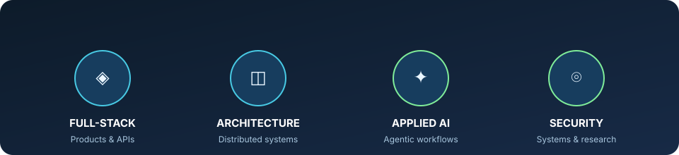

# Alireza Fadaei

### Full-Stack Software Engineer

**Java · React · Python | Application Architecture · Agentic AI**

Oulu, Finland · M.Sc. student at the University of Oulu

[Portfolio](https://arfadaei.ir) · [LinkedIn](https://www.linkedin.com/in/aliz-f/) · [ORCID](https://orcid.org/0009-0007-1187-7288) · [Email](mailto:alizfadaei98@gmail.com)

[Experience](#experience-in-practice) · [Projects](#project-directory) · [Stack](#core-stack) · [Research](#research--education) · [Contact](#currently-learning--open-to)

I build software end to end—from React interfaces and Python APIs to Java endpoint applications, distributed-system design, and AI-enabled workflows. My experience spans enterprise security and patch management, B2B platforms, customer-deployed products, and scientific software.

## Experience in practice

| Focus | What I do |
| --- | --- |
| **◈ Full-stack delivery** | Build React and JavaScript interfaces backed by Python services, REST APIs, validation, and relational data models. |
| **◫ Distributed security systems** | At Fardaad (2022–2024), contributed to a hierarchical patch and vulnerability-management platform: Python services and queues, Java agents for Windows/Linux endpoints, CVE enrichment, patch matching, and a management interface. |
| **✦ Applied AI workflows** | Develop structured enrichment and agentic workflows with web crawling, Pydantic models, optional LLM-assisted resolution, and restartable processing. |
| **⌾ Reliable delivery** | Work across architecture, integration, and testing. Fardaad used GitLab CI/CD; GitHub Actions is part of my recent project delivery work. |

## Project directory

| Project | What it demonstrates | Live demo / access | Source |
| --- | --- | --- | --- |
| **Matchline MVP** | Interactive football-media frontend with personalised journeys, predictions, local fan discussion, and a safe AI demo. React, TypeScript, Vite, Zustand, Leaflet. | [Open live demo](https://matchline.arfadaei.ir/) | [Repository](https://github.com/Aliz-f/matchline-mvp) |
| **Company Domain & Contact Enrichment** | Python enrichment pipeline with deterministic validation, controlled crawling, Pydantic schemas, checkpoints, Docker, and optional capped LLM resolution. | No public demo | [Repository](https://github.com/Aliz-f/company-domain-contact-enrichment) |
| **BrassicaLNC Research Platform** | Searchable scientific platform built from 2,361 public RNA-Seq libraries. I contributed React exploration views, Django REST APIs, PostgreSQL models, and operations. | [Open platform](https://brassica.arfadaei.ir/) | [Backend](https://github.com/Aliz-f/BrassicaLnc-Backend) · [Deployment](https://github.com/Aliz-f/BrassicaLnc-Backend/tree/master/deploy) |
| **CNC Process Management System** | Customer-deployed operational software for inventory, material flow, workstation monitoring, and process tracking. | [Open application](https://erp.arfadaei.ir) — demo login provided | Private/proprietary |
| **Psychological Clinic CRM** | Customer-deployed clinic software for appointments, clinician schedules, records, sessions, and billing. | [Open application](https://psy.arfadaei.ir) — demo login provided | Private/proprietary; no patient data published |
| **Federated Intrusion Detection** | Lightweight 1D-CNN and federated-learning experiments for intrusion detection in dew/IIoT settings, including IID and non-IID data. | No public demo | [Federated repository](https://github.com/Aliz-f/edge-web-attack-detection-federated) · [Centralized baseline](https://github.com/Aliz-f/edge-web-attack-detection-centralized) |

### Selected project notes

<strong>Matchline MVP</strong> — product prototype

An interactive football-media prototype built for the fan journey rather than the scoreboard alone. It deliberately uses fictional/local data and does not represent a production sports-data or payment service.

<strong>Company Domain &amp; Contact Enrichment</strong> — AI-assisted data workflow

The pipeline resolves candidate domains, validates them through DNS/HTTP checks, crawls resolved sites for contact data, and can use LLM assistance within a strict cap. Phase checkpoints make interrupted runs recoverable and idempotent.

<strong>Customer products</strong> — end-to-end ownership

For both the CNC system and clinic CRM, I owned frontend/backend implementation, data models, workflow logic, architecture, and deployment. The applications are deployed for customers; source is intentionally not public.

## Core stack

| Area | Tools and practices |
| --- | --- |
| **Languages & frontend** | Java, Python, JavaScript, React, HTML, CSS |
| **Backend & APIs** | FastAPI, Django, Flask, REST APIs, Pydantic |
| **Data & infrastructure** | PostgreSQL, Redis, Docker, Linux, Nginx |
| **Architecture & security** | Distributed systems, modular service design, queue-based processing, secure client-server communication, testing |
| **AI-assisted engineering & delivery** | LLM APIs, agentic workflows, web crawling, Codex, Claude Code, GitLab CI/CD, GitHub Actions |

## Research & education

**Published research** — *A Novel Intrusion Detection System for Dew Computing Environments Based on an Enhanced Federated Deep Learning Model*, *The Journal of Supercomputing* (2026). [DOI: 10.1007/s11227-026-08314-x](https://doi.org/10.1007/s11227-026-08314-x)

- **M.Sc., Software Engineering and Information Systems** — University of Oulu, Finland (2026–Present)
- **M.Sc., Software Engineering** — Azad University, Najafabad Branch, Iran (2022–2025)

## Teaching

I taught programming and software development through hands-on projects in Iran TVTO vocational programmes, alongside curriculum work in programming, network security, and machine learning.

## Currently learning & open to

I am open to full-stack or backend engineering opportunities, applied-AI work, and distributed-systems roles in Finland and across the EU.

[Portfolio](https://arfadaei.ir) · [LinkedIn](https://www.linkedin.com/in/aliz-f/) · [Contact via portfolio](https://arfadaei.ir/#contact-section) · [Email](mailto:alizfadaei98@gmail.com)
